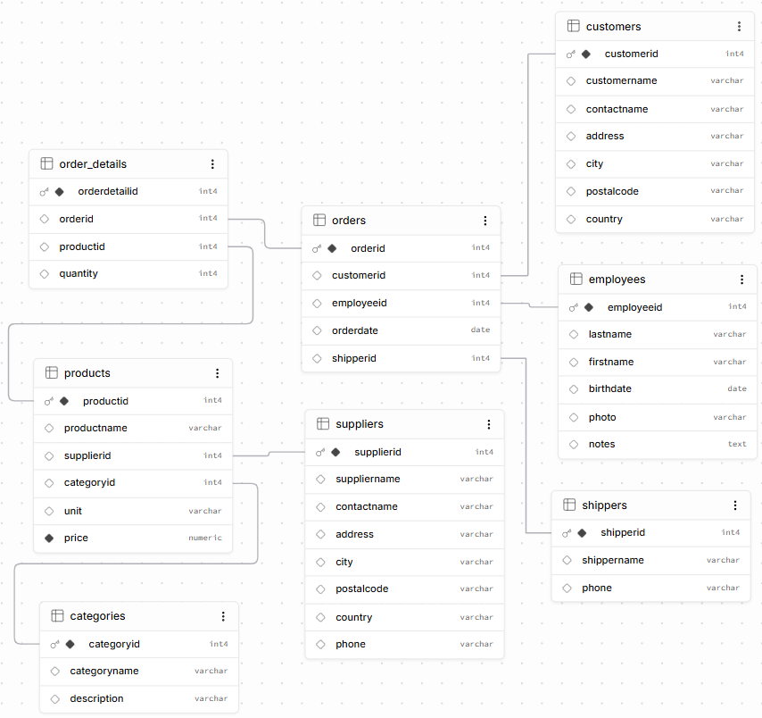
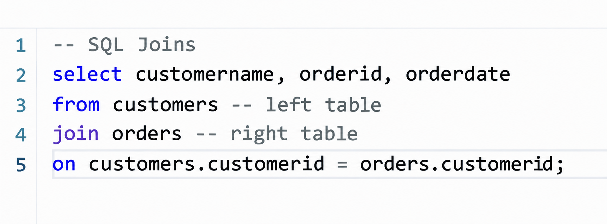

# 🗄️ SQL Projects – Data Technician Bootcamp

<p align="center">
  
  
  
  
</p>

---

> 🎯 **Project Overview:**  
> Practical coursework and hands-on exercises completed during Week 3 of the **Data Technician Bootcamp**. This repository covers relational database design concepts, database comparison (SQL vs. NoSQL), and running SQL queries on the **Northwind** and **World** databases using Supabase.

---

## 💡 What I Learned & Practiced

### 🛠️ Core Concepts
* 🔹 **Database Fundamentals:** Understanding primary keys, foreign keys, and table relationships.
* 🔹 **SQL vs. NoSQL:** Comparing structured relational tables with flexible document stores.
* 🔹 **Database Schema Design:** Designing entity-relationship blueprints for training systems.

### 🔍 SQL Querying Techniques
* 🔸 **Data Filtering:** Using `WHERE`, `LIKE`, `IN`, and `BETWEEN` operators.
* 🔸 **Sorting & Pagination:** Sorting results with `ORDER BY` and limiting rows via `LIMIT` / `OFFSET`.
* 🔸 **Aggregations & Grouping:** Calculating summaries using `COUNT`, `SUM`, `AVG`, and `GROUP BY`.
* 🔸 **Relational Joins:** Combining multi-table datasets using `INNER JOIN` and `LEFT JOIN`.

---

## 📂 Repository Contents

```text
📁 My-SQL-Projects/
├── 📄 Data_Technician_Workbook_Week_3_SB_June_2026.docx    # Theory & completed tasks
├── 📄 Create Northwind Tables on Supabase.docx             # Northwind schema setup script
├── 📄 Create World DB on Supabase.txt                      # World DB schema setup script
├── 📄 Day 2 Supabase SQL Queries.txt                       # Executed practice queries
└── 📄 README.md                                            # Repository documentation
```
---

## 💻 Sample SQL Queries


### 🏬 Northwind Database Tasks

* **Export Complete Customer Records:** The management requires a full dataset of all registered clients for internal auditing.  
➡️ *SQL query to select all fields from the Customers table.*

```sql
SELECT * 
FROM customers;
```

* **Targeted Customer Locations:** The marketing department needs a simplified view containing only client names and their respective cities.
- ➡️ *SQL query to extract CustomerName and City columns*

```sql
SELECT CustomerName, city 
FROM customers;
```

* **Distinct Customer Cities:** Logistics needs an overview of unique cities where active clients reside without repeating entries.
➡️ *SQL query to extract unique City entries from the Customers table.*

```sql
SELECT DISTINCT city 
FROM customers;
```

* **Premium Product Identification:** The sales team wants to analyze high-tier catalog items priced above £50.
➡️ *SQL query to retrieve items from the Products table with Price greater than 50.*

```sql
SELECT * 
FROM products 
WHERE price > 50;
```

* **Cross-Border Market Analysis (USA & UK):** Regional managers are preparing marketing campaigns targeting customers in the United Kingdom and United States.
➡️ *SQL query to fetch all customer records located in either 'USA' or 'UK'.*

```sql
SELECT * 
FROM customers 
WHERE country = 'USA' OR country = 'UK';
```

* **Latest Orders Chronology:** Operations requires a transaction breakdown organized by the most recent purchase date.
➡️ *SQL query to pull all orders sorted by OrderDate in descending order.*

```sql
SELECT * 
FROM orders 
ORDER BY orderdate DESC;
```

* **Mid-Tier Inventory Pricing:** Preparing an audit list of product inventory priced between £20 and £50.
➡️ *SQL query to filter Products table for price range 20–50, sorted highest to lowest.*

```sql
SELECT * 
FROM products 
WHERE price BETWEEN 20 AND 50 
ORDER BY price DESC;
```

* **US Local Metro Targeting:** Focusing promotional activity on customers based in Portland and Kirkland.
➡️ *SQL query for US customers residing in 'Portland' or 'Kirkland', sorted alphabetically.*

```sql
SELECT * 
FROM customers 
WHERE country = 'USA' AND city IN ('Portland', 'Kirkland') 
ORDER BY customername ASC;
```

* **Mapping Products to Vendors:** Inventory control needs to trace each product back to its original vendor.
➡️ *SQL query combining Products and Suppliers tables.*

```sql
SELECT p.productname, s.suppliername 
FROM products p 
JOIN suppliers s ON p.supplierid = s.supplierid;
```

* **Multi-Entity Order Consolidation:** Business analysis requires combining transaction details with matching customer profiles and employee names.
➡️ *SQL query joining Orders, Customers, and Employees tables.*

```sql
SELECT o.orderid, o.orderdate, c.customername, CONCAT(e.firstname, ' ', e.lastname) AS employeename 
FROM orders o 
JOIN customers c ON o.customerid = c.customerid 
JOIN employees e ON o.employeeid = e.employeeid;
```

* **Category Stock Count:** Product managers need to evaluate total product availability across each category.
➡️ *SQL query listing categories alongside their corresponding item counts.*

```sql
SELECT c.categoryname, COUNT(p.productid) AS product_count 
FROM categories c 
LEFT JOIN products p ON c.categoryid = p.categoryid 
GROUP BY c.categoryname;
```
---

### 📸 World DB Queries

* **US Cities Demographics Count:** Analyzing urban centers in the United States to calculate the total number of recorded cities.
➡️ *SQL query to count urban records for the 'USA' country code.*

```sql
SELECT COUNT(*) 
FROM city 
WHERE countrycode = 'USA';
```

* **Global Life Expectancy Metric:** Researching public health data to pinpoint the nation with the longest life expectancy.
➡️ *SQL query to find the highest life expectancy country.*

```sql
SELECT name, lifeexpectancy 
FROM country 
ORDER BY lifeexpectancy DESC 
LIMIT 1;
```

* **Major Population Hubs (>2M):** Real estate planners need a list of major global cities with populations over 2 million.
➡️ *SQL query to filter cities exceeding 2,000,000 residents.*

```sql
SELECT name, population 
FROM city 
WHERE population > 2000000 
ORDER BY population DESC;
```

* **Name Pattern Filtering ('Be'):** Content creators require a list of cities starting with the letters 'Be'.
➡️ *SQL query using pattern matching for city names.*

```sql
SELECT name 
FROM city 
WHERE name LIKE 'Be%';
```

* **Largest Global Mega-City:** Extracting the single most populated urban area from the database.
➡️ *SQL query to retrieve the highest populated city record.*

```sql
SELECT name, population 
FROM city 
ORDER BY population DESC 
LIMIT 1;
```

* **Spanish Capital Lookup:** Travel coordinators need to pull the official capital city of Spain.
➡️ *SQL query connecting Country and City tables to identify Spain's capital.*

```sql
SELECT ci.name AS capital_name 
FROM country co 
JOIN city ci ON co.capital = ci.id 
WHERE co.name = 'Spain';
```

* **European Cities Index:** Educational exchange teams require a complete list of cities situated in Europe.
➡️ *SQL query joining City and Country tables filtered by European continent.*

```sql
SELECT ci.name, co.name AS country_name 
FROM city ci 
JOIN country co ON ci.countrycode = co.code 
WHERE co.continent = 'Europe';
```

* **Paginated Ranking (Rows 31-40):** Market researchers require city records ranked between 31st and 40th by population.
➡️ *SQL query utilizing LIMIT and OFFSET for paginated results.*

```sql
SELECT * 
FROM city 
ORDER BY population DESC 
LIMIT 10 OFFSET 30;
```

---

## 💻 SQL Query Examples & Database Schema

### 1. 🗂️ Relational Database Schema (Northwind DB)
* **Task Description:** Designing and visualizing entity-relationship models for relational databases to understand table cardinalities, primary keys, and foreign keys.

  

* **Technical Explanation:**
  * **Entity Relationships:** Maps the relational architecture between `customers`, `orders`, `order_details`, `products`, and other core tables.
  * **Key Constraints:** Establishes data integrity using primary keys (`customerid`, `orderid`) and foreign keys to enable multi-table operations.

---

### 2. 🔗 SQL Multi-Table Joins
* **Task Description:** Writing and executing SQL queries to extract combined insights from multiple relational tables using `JOIN` operations.

  ```sql
  -- SQL Joins
  select customername, orderid, orderdate
  from customers -- left table
  join orders -- right table
  on customers.customerid = orders.customerid;
  ```
  
* **Technical Explanation:**
  * **Data Retrieval:** Uses the `SELECT` statement to pull specific customer names, order IDs, and dates.   * **Relational Matching:** Implements an `INNER JOIN` combining the `customers` and `orders` tables based on the matching `customerid` field.

---

| Tool / Technology | Usage Description |
| :--- | :--- |
| **PostgreSQL / Supabase** | Cloud database platform for hosting & running queries |
| **SQL** | Core language used for data manipulation and querying |
| **GitHub** | Version control & project portfolio hosting |

---

GitHub                  Version control & project portfolio hosting

